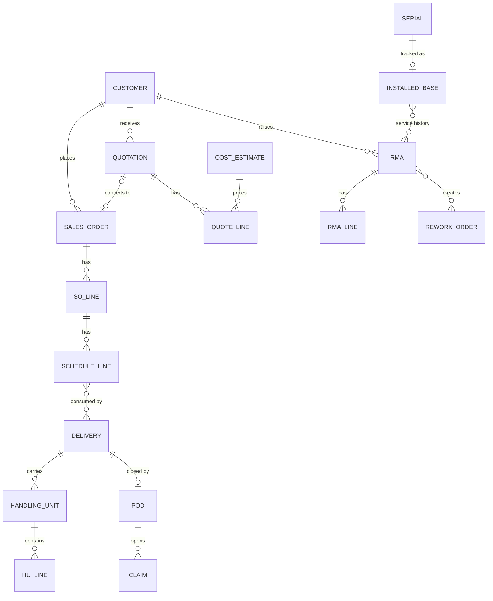
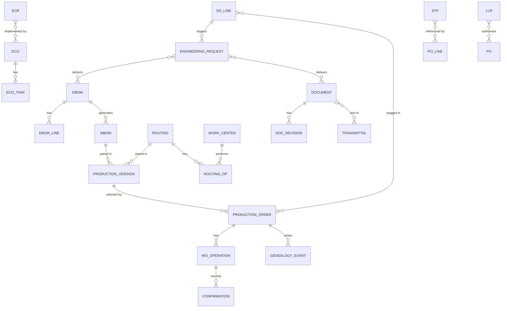
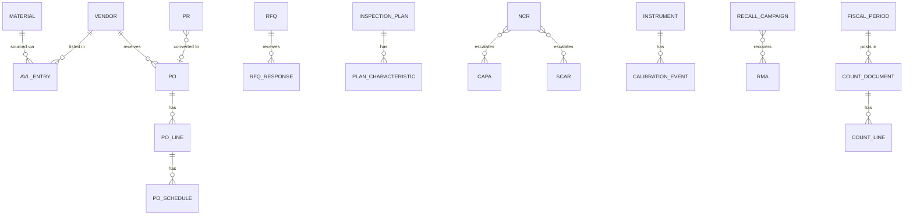
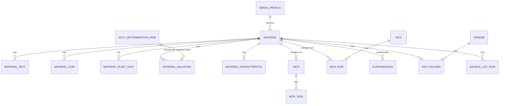

# TENTATIVE - Entity model sketch - pe-v2 (Phase 2A)

> **What this is.** A rough first map of the record types the transformer ERP keeps, how they link,
> and every status list the specification names, word for word. Designers use the status catalog to
> know which badge values a screen must handle; the consequences note says which buttons a screen
> may never offer.
>
> **Where it stands.** TENTATIVE, 9 October 2026. Read from the specification only; nobody has
> confirmed it. Never overwritten: the Phase 2B model will be a new file at `40-models/erd.md`.
>
> **What we need from you.** Nothing now (no questions, by your instruction). If a status list
> below is wrong or incomplete, name its row number.

**Sources.** The eight section digests, `10-discovery/anchor-analysis.md`, `10-discovery/glossary.md`,
and targeted page reads of the specification (entity tables p.128 and pp.169-170, and each status
table cited by page). Every row is `[DOC:p.n]` (the client's specification, with its page) and
`(asserted)` (written down once, not confirmed by the domain expert). Nothing here is (confirmed).

**Lite mode and low rule density.** Entity cards are collapsed to key fields plus links (rule_density
low). The status pass is still run, because a status list means the record is rule-bearing whatever
the config says. Lifecycle, permission and frozen-versus-live decisions are carried only where the
specification states them, in the consequences note.

ASSUMPTIONS this file rests on: ASM-EXT-1 (INV V3.0 and ACC V2.0 behave as referenced; records owned
by them, such as NCR, invoice, GRN and serial, are shown as links only).

Open readings made while drafting this file are in `10-discovery/open-questions.md` OQ-18 to OQ-24.
Contradictions found are in `STATE.md > Open contradictions` K-13 to K-19.

---

## 1. Entities

Key fields and links as the specification lists them. "How many of each" is filled only where the
specification states it; otherwise it reads "not stated".

| # | Entity (spec name) | Key fields (spec) | Links to | How many of each, where stated | Source |
|---|---|---|---|---|---|
| *E-0* | *Example: Handling Unit* | *hu_id, type, weights, sscc* | *SOLines, Picklists, PackOrders* | *exactly one transformer serial per primary HU* | *[DOC:p.128; p.31] (asserted)* |
| E-1 | Customer (+ Address, Contact, Tax Profile) | customer_id, class, status, price_list_id, credit_limit, hold_flag | Addresses, Contacts, Tax Profile, SOs, RMAs | one default Bill-To and one default Ship-To; unlimited addresses | [DOC:p.128; p.49] (asserted) |
| E-2 | Quotation / QuoteLine | qt_id, version, status, valid_until; line: item_id, config_json, ce_id, price, source | Customer, Cost Estimate, SO (conversion) | a revision is a full copy as -V(n+1); predecessor Superseded | [DOC:p.128; p.51] (asserted) |
| E-3 | SalesOrder / SOLine | so_id, type, status, billing_plan; line: item_id, qty, price, promised_date, peg refs | Customer, Quote, WO, Shipments, Invoices, Revenue Contract | not stated | [DOC:p.128] (asserted) |
| E-4 | Schedule line | status, peg reference (reservation / WO / PR / planned order) | SO line; consumed by delivery documents | delivery documents consume schedule lines, never raw order lines | [DOC:p.206 §2] (asserted) |
| E-5 | Shipment (delivery) / HandlingUnit / HULine | shp_id, status; hu_id, type, weights, sscc; contents | SOLines, Picklists, PackOrders | exactly one transformer serial per primary HU | [DOC:p.128; p.31 §5; p.207] (asserted) |
| E-6 | POD / Claim | POD status, receiver, date, condition notes; claim type, qty/value, carrier claim ref | Delivery; claims reuse RMA and credit paths | one POD per delivery | [DOC:p.207 §2.4] (asserted) |
| E-7 | RMA / RMALine | rma_id, class, status, warranty_flag; line: item, serial, qty auth/recd, disposition | Customer, Invoice, CreditNote, RWO, NCR | authorized qty may be received across multiple receipts | [DOC:p.128; p.26 §3.9] (asserted) |
| E-8 | Installed Base record | customer, site, POD date, commissioning date, status | shipped FIN serial; RMA, RWO, deviations, campaigns | one per shipped FIN serial | [DOC:p.215 §7.4] (asserted) |
| E-9 | EngineeringRequest | er_id, so_line_id, design_type, due, status, checklist | SOLine, EBOM, Documents | not stated | [DOC:p.128; p.59] (asserted) |
| E-10 | EBOM / EBOMLine | ebom_id, parent_item, rev, status; line: component, qty, scrap, op_map, effectivity | Items, MBOM, Documents, ECOs | not stated | [DOC:p.128] (asserted) |
| E-11 | MBOM | revision, status | EBOM (source), parent item | one Active revision; prior Active becomes Superseded | [DOC:p.66 §6] (asserted) |
| E-12 | Production Version | material, plant, lot-size band, valid from/to, status | MBOM + routing; selected by WO and MRP | exactly one valid version per material, plant, lot-size band and date (V-PV-01) | [DOC:p.214] (asserted) |
| E-13 | Document / DocRevision / Transmittal | doc_id, type, security; rev, files, status; recipients and responses | Items, BOM lines, Routings, WOs, SOs | not stated | [DOC:p.128; p.64 §5] (asserted) |
| E-14 | ECR / ECO / ECOTask | ecr_id, impact snapshot, ccb votes; eco_id, effectivity, dispositions; tasks | affected objects | one ECO may implement several ECRs | [DOC:p.128; p.62 §4.2] (asserted) |
| E-15 | LLR (long-lead purchase release) | LLR-{YYYY}-{SEQ:4}, items, qty and value caps, revision basis, risk class | design package version; POs | not stated | [DOC:p.209 §3.2] (asserted) |
| E-16 | STP (supplier technical package) | STP-{SEQ:6}, drawing revisions, specs, clauses, checksum, version | RFQ lines, PO lines | each RFQ and PO line references exactly one STP version | [DOC:p.209 §3.3] (asserted) |
| E-17 | WorkCenter / Routing / RoutingOp | wc_id, cc_id, capacity, rates; rtg_id, rev, status; op: hours, qc_flag, wi docs | CostCenter, WOs | not stated | [DOC:p.128] (asserted) |
| E-18 | ProductionOrder (WO) / WOOperation / Confirmation | wo_id, item, serial, revs, status, pegs; op status; conf: qtys, hours, operator | MBOM, Routing, SOLine, Inspections, GL | not stated | [DOC:p.128] (asserted) |
| E-19 | ReworkOrder (RWO) | rwo_id, origin, receiver, status | WO / RMA / NCR | not stated | [DOC:p.128] (asserted) |
| E-20 | GenealogyEvent / SerialLink / BatchConsumption | per Part F §5 | Serials, Batches, WOs | not stated | [DOC:p.128; p.98] (asserted) |
| E-21 | Warehouse task | task type, assignment, device, status | picklists, putaway proposals (documents stay the record) | not stated | [DOC:p.215 §7.2] (asserted) |
| E-22 | Vendor | onboarding status, quality approval status, compliance docs | AVL, POs | not stated | [DOC:p.101 §2] (asserted) |
| E-23 | AVLEntry | item_id, vendor_id, rank, status, price_basis, fai_ref | Item, Vendor | not stated | [DOC:p.128] (asserted) |
| E-24 | PR / RFQ / RFQResponse / PO / POLine / POSchedule | standard procurement chain with revisions | Vendors, Items, WO/SO pegs, GRNs | not stated | [DOC:p.128] (asserted) |
| E-25 | CostCenter / ProfitCenter / Hierarchy / SKF / AllocationCycle | per Part H | every journal item | not stated | [DOC:p.128] (asserted) |
| E-26 | CostEstimate / CostingRun / WCRateVersion | per Part I | Items, Quotes | not stated | [DOC:p.128] (asserted) |
| E-27 | PriceList / PriceListRate / CustomerPrice / SurchargeRule / IndexValue | per Part I §6 | Items, Customers | not stated | [DOC:p.128] (asserted) |
| E-28 | InspectionPlan / PlanCharacteristic | per Part A §6 | Items, Vendors, Operations, Inspections | not stated | [DOC:p.128] (asserted) |
| E-29 | CountDocument / CountLine | CD-{plan}-{SEQ:3}; location, item, batch, UoM, expected, count, recount qty | CountPlan, Locations, SAs | one count document per counting unit (default per zone per counter team) | [DOC:p.128; p.36 §7.1] (asserted) |
| E-30 | CAPA / SCAR / Instrument / CalibrationEvent | per Part E | NCRs, Vendors, Tests | not stated | [DOC:p.128] (asserted) |
| E-31 | Recall Campaign (RCL) | RCL-{YYYY}-{SEQ:3} | batch/serial holds; RMA class Recall | not stated | [DOC:p.182 FL-08] (asserted) |
| E-32 | Deviation / Waiver (DEV) | DEV-{YYYY}-{SEQ:4}, scope, type, spec reference | material / batch / WO / serial set / customer | not stated | [DOC:p.215 §7.3] (asserted) |
| E-33 | Fiscal period | entity, month, status | every posting transaction | one period record per entity per month, two presentations | [DOC:p.41 §9.1] (asserted) |
| E-34 | material | material_id, material_no (unique), type, groups, base_uom, status, batch_flag, serial_profile_id | every module | not stated | [DOC:p.169 §18.1] (asserted) |
| E-35 | material_text / material_uom / material_characteristic | lang, descriptions; uom, numerator, denominator; class, attr_key | material | unique (material_id, uom) | [DOC:p.169] (asserted) |
| E-36 | material_plant_data | material_id, plant_id, plant-level groups, status per plant | material, plant | unique (material_id, plant_id); exists from day one with one plant | [DOC:p.169] (asserted) |
| E-37 | material_valuation | material_id, plant_id, entity_id, valuation_class, method, std_cost, mav, history rows | account determination | effective-dated, no updates in place | [DOC:p.169] (asserted) |
| E-38 | mcr / mcr_task | mcr_id, material_id, origin_ref, status; task: view, owner_role, sla_due, status | material, users | not stated | [DOC:p.169] (asserted) |
| E-39 | mch / mch_row | mch_id, status, approval refs; row: material_id, field, old, new, applied_at | materials, ECO | not stated | [DOC:p.169] (asserted) |
| E-40 | supersession | sup_id, predecessor_id, successor_id, policy, effective, status | materials, ECO | not stated | [DOC:p.169] (asserted) |
| E-41 | info_record / source_list_row | ir_id, material_id, vendor_id, entity_id; valid_from/to, fixed, blocked | material, vendor, PO pricing | one active info record per material, vendor and entity | [DOC:p.169] (asserted) |
| E-42 | acct_determination_row | event_key, valuation_class, qualifier, dr_key, cr_key, version | Posting Service | not stated | [DOC:p.169] (asserted) |
| E-43 | special_stock_bucket / batch (extended) / serial_profile | owner_type, peg_type; vendor_batch, heat_no; profile_id, timing, format | INV stock and batch tables, material | extends INV tables, no parallel table | [DOC:p.169] (asserted) |
| E-44 | eo_reserve_run / row | run_id, period, policy version; material_id, bucket, value, reserve_delta | GL | not stated | [DOC:p.170] (asserted) |

**Linked but owned elsewhere** (INV V3.0 / ACC V2.0, not supplied, ASM-EXT-1): Invoice, CreditNote,
Revenue Contract, GRN, NCR (INV 15.4), Serial, Batch, Picklist, PackOrder, CountPlan, Location,
Inspection lot, journal [DOC:p.83; p.128; p.204 §1.1] (asserted).

**Entity count.** 44 entity rows above, holding 92 named record types (header and line pairs counted
separately) [DOC:p.128; pp.169-170; pp.206-215] (asserted).

## 2. Diagrams

The connector shapes below show which records link. Where section 1 says "not stated", the shape
is a drawing default and not a claim about how many of each (see OQ-19). Sources: section 1 rows.

## 3. Status catalog

Every record type with a lifecycle, with its statuses exactly as the specification names them, in
the specification's order. Colours are the specification's own, where it gives them. "Terminal" is
filled only where the specification says so.

| # | Record | Statuses as the PRD names them | Count | Transitions, where stated | Terminal, as stated | Source |
|---|---|---|---|---|---|---|
| *S-0* | *Example: Handling Unit* | *Open (packing), Closed (contents locked, label printed), Loaded (assigned to shipment), Shipped* | *4* | *Open → Closed → Loaded → Shipped; reopen allowed until Loaded, reason logged* | *not stated* | *[DOC:p.31 §5] (asserted)* |
| S-1 | Customer | Prospect, Active, On Hold, Blocked, Inactive | 5 | not stated; Credit Hold is a separate manual flag plus auto-hold rule | not stated | [DOC:p.49 §2] (asserted) |
| S-2 | Quotation | Draft (gray), Internal Review (yellow), Issued (blue), Won (green), Lost (red), Expired (gray), Superseded | 7 | Draft → Internal Review → Issued → Won / Lost / Expired; Revise on Issued: predecessor → Superseded, copy in Draft | not stated | [DOC:p.51 §3.3] (asserted) |
| S-3 | Sales order | Draft (gray), Submitted (yellow), Credit Hold (red), Confirmed (blue), In Fulfillment (purple), Partially Shipped (teal), Shipped (green), Invoiced / Closed (dark green), Cancelled (red) | 9 | Draft → Submitted → Confirmed / Credit Hold / Rejected; Credit Hold → Confirmed / Cancelled; Confirmed → In Fulfillment → Partially Shipped / Shipped → Invoiced; Reopen: Controller | Invoiced / Closed; Cancelled | [DOC:p.54 §4.6] (asserted) |
| S-4 | Sales order line | Open, In Engineering, In Production, Ready to Ship, Partially Shipped, Shipped, Invoiced, Closed, Cancelled | 9 | not stated | not stated | [DOC:p.53 §4.2] (asserted) |
| S-5 | Schedule line | Open, Confirmed, Allocated/Pegged, Delivery Due, Partially Delivered, Delivered, Closed / Cancelled | 8 | Open → Confirmed → Allocated/Pegged → Delivery Due → Partially Delivered → Delivered → Closed / Cancelled | not stated | [DOC:p.206 §2] (asserted) |
| S-6 | Delivery | Planned, Released, Picking, Packed, Quality Cleared, Loaded, PGI, Delivered/Closed | 8 | Planned → Released → Picking → Packed → Quality Cleared → Loaded → PGI → Delivered/Closed; PGI reversal sets delivery back to Packed | not stated | [DOC:p.207 §2.4; p.208] (asserted) |
| S-7 | POD | Expected, Received, Exception, Resolved/Closed | 4 | Expected → Received / Exception → Resolved/Closed | not stated | [DOC:p.207 §2.4] (asserted) |
| S-8 | Handling Unit | Open, Closed, Loaded, Shipped | 4 | Open → Closed → Loaded → Shipped; reopen until Loaded; PGI reversal sets HUs to Loaded | not stated | [DOC:p.31 §5; p.208] (asserted) |
| S-9 | RMA | Draft (gray), Pending Approval (yellow), Authorized (blue), Partially Received (teal), Received (purple), In Inspection (purple), Disposition Pending (amber), Settling (amber), Closed (green), Rejected / Cancelled (red) | 11 | Draft → Pending Approval → Authorized / Rejected / Draft; Authorized → Partially Received / Received / Cancelled; Partially Received → Received / Closed Short; Received → In Inspection → Disposition Pending → Settling → Closed; Closed → Reopened (Controller, 30 days) | Rejected / Cancelled ("Terminal") | [DOC:p.26 §3.8] (asserted) |
| S-10 | RMA warranty claim badge | Yes (amber), No (gray), Approved (green), Denied (red) | 4 | not stated | not stated | [DOC:p.22 §3.3] (asserted) |
| S-11 | Installed Base record | Shipped, Installed, In Service, Returned, Scrapped | 5 | not stated | not stated | [DOC:p.215 §7.4] (asserted) |
| S-12 | Engineering request | Open, In Design, Customer Review, Released, Closed; Blocked | 6 | Open → In Design → Customer Review (optional loop) → Released → Closed; Blocked (with reason) from any state | not stated | [DOC:p.59 §2] (asserted) |
| S-13 | EBOM | Draft (gray), In Review (yellow), Released (green), Superseded (blue), Obsolete (red) | 5 | In Review: Approve → Released, Reject → Draft | not stated | [DOC:p.61 §3.4] (asserted) |
| S-14 | MBOM | Active, Superseded | 2 named | on release: new revision Active, prior Active → Superseded | not stated | [DOC:p.66 §6] (asserted) |
| S-15 | Routing | Draft, In Review, Released, Superseded | 4 | Draft → In Review → Released → Superseded; changes via ECO | not stated | [DOC:p.73] (asserted) |
| S-16 | Document | WIP (gray), In Review (yellow), Released (green), Superseded (blue), Obsolete (red) | 5 | WIP → In Review → Released → Superseded → Obsolete | not stated | [DOC:p.64 §5.2] (asserted) |
| S-17 | Design package release level | Concept, Preliminary / RFQ Package, Long-Lead Purchase Release (LLR), Approved for Purchase, Released for Production, Superseded / Obsolete | 6 | levels only move forward except via ECO | not stated | [DOC:pp.208-209 §3.1] (asserted) |
| S-18 | Production version | Draft, Released, Superseded/Obsolete | 3 | Draft → Released (Engineering Manager) → Superseded/Obsolete; ECO cutover swaps versions atomically | not stated | [DOC:p.214] (asserted) |
| S-19 | STP vendor acknowledgement | Acknowledged, Exception (deviation raised), Rejected | 3 | not stated | not stated | [DOC:p.209 §3.3] (asserted) |
| S-20 | Work center | Active, Maintenance, Inactive | 3 | not stated | not stated | [DOC:p.71] (asserted) |
| S-21 | Production order (WO) | Created (gray), Released (blue), In Progress (purple), Testing (amber), Completed (green), Closed (TECO) (dark green), On Hold (red), Cancelled (red) | 8 | Start Operation scan sets In Progress; stays Testing until Pass or scrap disposition | Cancelled ("Terminal") | [DOC:pp.74-75 §5.3; p.76; p.87] (asserted) |
| S-22 | Rework order | Open, In Progress, Completed, Settled | 4 | Open → In Progress → Completed → Settled | not stated | [DOC:p.79] (asserted) |
| S-23 | Warehouse task | Queued, Assigned, In Progress, Done/Exception | 4 | Queued → Assigned → In Progress → Done/Exception | not stated | [DOC:p.215 §7.2] (asserted) |
| S-24 | Inspection plan | Draft (gray), In Review (yellow), Active (green), Superseded (blue), Obsolete (red) | 5 | Draft → In Review → Active / Draft; Active → Superseded (auto at next revision) / Obsolete | Superseded, Obsolete ("Terminal") | [DOC:p.34 §6.4] (asserted) |
| S-25 | CAPA | Open, Analysis, Actions In Progress, Implemented, Effectiveness Check, Closed, Reopened | 7 | Open → Analysis → Actions In Progress → Implemented → Effectiveness Check → Closed / Reopened; failed check reopens actions | not stated | [DOC:p.88] (asserted) |
| S-26 | Calibration instrument | In Cal (green), Due Soon (amber), Overdue (red), Out of Service | 4 | not stated; alerts at 30/14/3 days | not stated | [DOC:p.90] (asserted) |
| S-27 | Recall campaign | Identify, Contain, Notify, Recover, Disposition, Effectiveness, Closed | 7 | Identify → Contain → Notify → Recover → Disposition → Effectiveness → Closed | not stated | [DOC:p.182 FL-08] (asserted) |
| S-28 | Stock status (named values) | Unrestricted, QI Hold, Blocked, Quarantine | 4 named | QI Hold → Unrestricted on pass; Blocked on fail | not stated | [DOC:pp.84-85] (asserted) |
| S-29 | Serial status (named values) | Available, QI Hold, In Production, Reserved, Picked, Shipped | 6 named | PGI reversal: Shipped → Reserved | not stated | [DOC:p.95; p.32; p.208] (asserted) |
| S-30 | Vendor onboarding | Draft, Docs Pending, Under Review, Active | 4 | Draft → Docs Pending → Under Review → Active | not stated | [DOC:p.101 §2.1] (asserted) |
| S-31 | Vendor quality approval | Approved, Conditional, Restricted, Disqualified | 4 | driven by SCAR enforcement and vendor rating | not stated | [DOC:p.101 §2.1] (asserted) |
| S-32 | AVL qualification | Qualified (green), Conditional, Suspended | 3 | not stated | not stated | [DOC:p.101 §2.2] (asserted) |
| S-33 | Purchase requisition | Open, In Approval, Approved, Converted, Rejected, Cancelled | 6 | Open → In Approval (manual/expense only) → Approved → Converted / Rejected / Cancelled | not stated | [DOC:p.102 §3] (asserted) |
| S-34 | RFQ | Draft, Issued, Responses In, Awarded, Cancelled | 5 | Draft → Issued → Responses In → Awarded / Cancelled | not stated | [DOC:p.103 §4] (asserted) |
| S-35 | Purchase order | Draft, In Approval, Approved, Sent, Confirmed, Partially Received, Received, Matched/Closed, Cancelled; Change Pending overlay | 9 + overlay | Draft → In Approval → Approved → Sent → Confirmed → Partially Received → Received → Matched/Closed; Cancelled | not stated | [DOC:p.104 §5.1] (asserted) |
| S-36 | PO line | Open, Partial, Received, Closed, Cancelled | 5 | not stated | not stated | [DOC:p.104 §5.2] (asserted) |
| S-37 | Cost center / profit center | Active, Blocked, Inactive | 3 | not stated | not stated | [DOC:p.111] (asserted) |
| S-38 | Cost estimate | Draft, Released, Superseded | 3 | Draft → Released (locks values) → Superseded | not stated | [DOC:p.119 §3.1] (asserted) |
| S-39 | Price list | Draft, Pending Approval, Active, Archived | 4 | Draft → Pending Approval → Active → Archived | not stated | [DOC:p.122 §6.1] (asserted) |
| S-40 | Count document | Generated (gray), Assigned (blue), Counting (yellow), Submitted (purple), Recount (amber), Variance Review (amber), Approved (green), Posted (dark green), Void (red) | 9 | Generated → Assigned / Void; Assigned → Counting → Submitted → Recount / Variance Review; Variance Review → Approved / Counting (rejected lines); Approved → Posted | Posted, Void ("Terminal") | [DOC:p.36 §7.2] (asserted) |
| S-41 | Fiscal period | Open, Soft Close, Hard Close, Year-End Closed (finance); shown in inventory as Open, Closing, Closed | 4 (+3 labels) | Open → Soft Close → Hard Close; reopen Closed → Soft Close needs Controller + CFO | not stated | [DOC:p.41 §9.1; p.42 §9.3] (asserted) |
| S-42 | Material lifecycle | Draft (gray), Data Completion (yellow), Active (green), Restricted (amber), Blocked (red), Obsolete (dark red) | 6 | Draft → Data Completion / Deleted; Data Completion → Active / Draft / Rejected; Active → Restricted / Blocked / Obsolete; Restricted → Active / Blocked / Obsolete; Blocked → Active / Restricted / Obsolete | Obsolete ("Terminal for use") | [DOC:p.149 §4.1] (asserted) |
| S-43 | Material function-specific blocks (additive chips) | Purchasing Block, Sales Block, Production Block, Shipping Block, Posting Block | 5 | set on Active/Restricted material with reason code | not stated | [DOC:p.151 §4.5] (asserted) |

**Lifecycle count.** 43 status lists (S-1 to S-43). The specification itself claims "18 complete
workflows" of status lifecycles [DOC:p.132 K5] (asserted); which 18 it means is not said (OQ-23).

**Named lifecycles with no status list in the specification.** These records carry a `status`
field or a decision outcome, but no value list is given: ECR (CCB outcome Approve / Reject / Defer)
[DOC:p.62 §4.1], ECO and ECO task [DOC:p.62 §4.2], MCR and MCR task [DOC:p.169], MCH [DOC:p.169],
supersession [DOC:p.169], SCAR [DOC:p.89], Deviation / Waiver [DOC:p.215 §7.3], LLR object
[DOC:p.209 §3.2], RMA line ("per-line status") [DOC:p.26 §3.7], approval request on the shared
engine [DOC:p.10 W.1], NCR (owned by INV 15.4, not supplied) [DOC:p.83] (all asserted). See OQ-21.

**Count check against the digests.** Digest 02 says SO 8 and WO 7; the page tables have 9 and 8
rows. Digest 03 says RFQ 4; the page has 5 values [DOC:p.54; pp.74-75; p.103] (asserted). This file
uses the page tables (OQ-20).

## 4. Consequences note for designers

One line per rule that limits what a screen may offer. Each comes from the page cited.

| # | Rule | What the interface must do | Source |
|---|---|---|---|
| *C-0* | *HU reopen only until Loaded* | *Reopen control disappears at Loaded; reopen asks for a reason* | *[DOC:p.31 §5] (asserted)* |
| C-1 | One shared approval engine; no module builds its own | Every approve / reject control uses one shared pattern and inbox; no per-module approval UI | [DOC:p.10 W.1] (asserted) |
| C-2 | No delegation of financial approvals above $250k | The delegate option is absent on financial approvals above $250k | [DOC:pp.10-11 W] (asserted) |
| C-3 | RMA delete exists only in Draft | Delete appears only on Draft RMAs; later statuses offer Cancel or Reject | [DOC:p.26 §3.8] (asserted) |
| C-4 | RMA reopen: Controller only, within 30 days of Closed | Reopen is shown only to the Controller, only inside the 30-day window | [DOC:p.26 §3.8] (asserted) |
| C-5 | RMA Close Short is a supervisor action and records why | Close Short needs supervisor rights and a reason field | [DOC:p.26 §3.9] (asserted) |
| C-6 | RMA cannot close while a linked credit note, WO or replacement SO is open | Close is disabled with the open linked documents listed | [DOC:p.21 §3] (asserted) |
| C-7 | RMA activity tab is an immutable audit trail | No edit or delete on activity entries | [DOC:p.26 §3.7] (asserted) |
| C-8 | Unknown serial on a no-reference return: line flagged Unverified Serial, warranty Denied | Show the Unverified Serial flag and Denied badge; no manual warranty toggle until verified | [DOC:p.26 §3.9] (asserted) |
| C-9 | Issued quote content is locked; changes go through Revise (new version) | Edit disappears at Issued; Revise creates -V(n+1) and marks the old one Superseded | [DOC:p.51 §3.3] (asserted) |
| C-10 | Quote to order only from Won; prices copied and frozen | Convert to Order appears only on Won quotes; order prices show Price Source = Quotation | [DOC:p.51 §3.3] (asserted) |
| C-11 | Lost quote needs a loss reason | Setting Lost opens a required reason picker | [DOC:p.50 §3.1] (asserted) |
| C-12 | Credit Hold is released only by Finance | Release / reject / raise limit live in the Finance queue, not on the sales screen | [DOC:p.49 §2.2; p.11 W.4] (asserted) |
| C-13 | Closed sales orders reopen only by the Controller | Reopen on Invoiced / Closed is Controller-only | [DOC:p.54 §4.6] (asserted) |
| C-14 | Released EBOM is immutable; any change needs an ECO | No edit on Released EBOMs; offer "raise ECR" instead | [DOC:p.61 §3.4] (asserted) |
| C-15 | EBOM mass replace always creates an ECO; never silent | Mass update ends in an ECO, not a direct save | [DOC:p.61 §3.3] (asserted) |
| C-16 | Obsolete EBOMs cannot be used in new MBOMs or orders | Obsolete items are excluded from pickers | [DOC:p.61 §3.4] (asserted) |
| C-17 | Document check-out locks it; Engineering Manager may force-release, logged | Show who holds the lock and since when; force-release only for Engineering Manager | [DOC:p.64 §5.2] (asserted) |
| C-18 | Shop floor never shows a superseded drawing | Shop-floor drawing views resolve to the current released revision only | [DOC:p.64 §5.2] (asserted) |
| C-19 | ECO cannot close with open tasks; release is atomic | Close is disabled while tasks are open; no partial-release control exists | [DOC:p.62 §4.2] (asserted) |
| C-20 | Immediate effectivity blocks all open WOs and needs QM + EM joint release | Immediate effectivity shows the WOs it will block and needs two approvers | [DOC:p.63 §4.5] (asserted) |
| C-21 | Release levels move forward only, except via ECO | No "lower release level" control; going back starts an ECO | [DOC:p.209 §3.1] (asserted) |
| C-22 | STP is immutable; a superseded STP cannot attach to new RFQ or PO lines | No edit on an STP; pickers exclude superseded versions | [DOC:p.209 §3.3] (asserted) |
| C-23 | Receipt is hard-blocked when the vendor never acknowledged a revised STP | Receiving shows error E-DTS-04 and cannot post | [DOC:p.209 §3.3] (asserted) |
| C-24 | Only one valid production version per material, plant, lot-size band and date | Saving an overlapping version is refused (V-PV-01) | [DOC:p.214] (asserted) |
| C-25 | WO On Hold requires a reason; Closed (TECO) locks the order | Hold opens a required reason; no edits after Closed (TECO) | [DOC:pp.74-75 §5.3] (asserted) |
| C-26 | WO stays Testing until Pass or scrap disposition | No manual move out of Testing | [DOC:p.87] (asserted) |
| C-27 | CAPA effectiveness check at least 30 days after implementation; Fail reopens actions | Effectiveness check is unavailable before day 30; Fail returns to actions | [DOC:p.88] (asserted) |
| C-28 | Two or more overdue SCARs set the vendor's AVL status to Restricted | New POs to that vendor need a Purchasing Manager override | [DOC:p.89] (asserted) |
| C-29 | Inspections using an Overdue or Out of Service instrument are blocked | Recording results with such an instrument fails with E-QM-05 | [DOC:p.90] (asserted) |
| C-30 | Inspection plan delete only in Draft; Obsolete is Quality Manager only, blocked if it leaves a QI item with no plan | Delete only on Draft; Set Obsolete only for QM and disabled in that case | [DOC:p.34 §6.4] (asserted) |
| C-31 | No PO before vendor onboarding is Active | PO creation for a non-Active vendor is blocked | [DOC:p.101 §2.1] (asserted) |
| C-32 | Restricted vendor needs Purchasing Manager override; Disqualified hard-blocks | Override path for Restricted only; no path for Disqualified | [DOC:p.101 §2.1] (asserted) |
| C-33 | RFQ responses sealed from other vendors always, and from the buyer until the due date when Sealed is on | Response values hidden until the due date | [DOC:p.103 §4] (asserted) |
| C-34 | PO approval ladder: Buyer to $25k, Purchasing Manager to $250k, then Controller, CFO above $1M | Approve control works only within the user's band | [DOC:p.11 W.4; p.104] (asserted) |
| C-35 | Released cost estimate locks values; quote margin uses only Released estimates | No edit on Released estimates; margin panel ignores Draft ones | [DOC:p.119 §3.1] (asserted) |
| C-36 | Below-floor prices route Pricing Manager → Sales Director → CFO (floor less 5 points) | Below-floor price entry shows the approval route and requires justification | [DOC:p.122 §6.3] (asserted) |
| C-37 | Blind count: counters never see expected quantity, enforced by the server | Expected and variance columns do not exist on the counter's screen | [DOC:p.36 §7.3] (asserted) |
| C-38 | Recounter must differ from the original counter (R-CNT-02) | Recount assignment refuses the original counter | [DOC:p.36 §7.2] (asserted) |
| C-39 | Count Void only before counting, with a reason; Posted documents are immutable | Void only in Generated; no edits after Posted | [DOC:p.36 §7.2] (asserted) |
| C-40 | Locations under an active count are frozen for movements (E-CNT-01) unless Soft Freeze is off | Movement screens show the frozen-location error; moved lines get the Moved During Count flag | [DOC:p.36 §7.2] (asserted) |
| C-41 | Posting into a Closed period is blocked for everyone; corrections post now with a Reference Date | No back-dating into Closed periods; offer Reference Date instead | [DOC:p.42 §9.4] (asserted) |
| C-42 | Soft Close warns, it does not block | Show the E-PER-02 warning banner and let the posting proceed | [DOC:p.42 §9.5] (asserted) |
| C-43 | Reopening a Hard Closed period needs Controller + CFO, two distinct users, in sequence | Reopen is a two-step, two-person action | [DOC:p.42 §9.5] (asserted) |
| C-44 | Master data is not period-controlled | Master data screens show no period warnings | [DOC:p.41 §9.2] (asserted) |
| C-45 | Material physical delete only from Draft with zero references | Delete appears only on Draft materials with no references | [DOC:p.149 §4.1] (asserted) |
| C-46 | Material type and number are immutable; numbers are never reused | Type and number are read-only after creation | [DOC:p.169 §18.1; p.170 §18.2] (asserted) |
| C-47 | Materials are created only through an MCR, never directly Active | No "create material" form; the entry point opens an MCR | [DOC:p.170 §18.3] (asserted) |
| C-48 | Obsolete needs zero stock and all documents closed (V-MM-20) | Set Obsolete is disabled with the blocking stock and documents listed | [DOC:p.149 §4.1] (asserted) |
| C-49 | Function-specific blocks are additive chips with reason code, set-by and date | Blocks render as chips beside, not instead of, the lifecycle badge | [DOC:p.151 §4.5] (asserted) |
| C-50 | Effective-dated records are never edited in place | Price, valuation and source-list edits create a new dated row; history stays visible | [DOC:p.170 §18.2] (asserted) |
| C-51 | PGI reversal: Shipping Manager only, before invoice, same fiscal period, reason mandatory | Reverse PGI appears only in that window and role, with a required reason | [DOC:p.208] (asserted) |
| C-52 | Recall external notification text needs Quality Manager + executive approval | Send is blocked until both approvals exist | [DOC:p.182 FL-08] (asserted) |
| C-53 | Genealogy is append-only and hash-chained | No edit or delete on genealogy events; corrections are new events | [DOC:p.212 §4] (asserted) |
| C-54 | Label reprint needs a reason | Reprint asks for a reason | [DOC:pp.93-97 F] (asserted) |
| C-55 | Every Detail header carries a status badge and lifecycle strip; terminal statuses are read-only | Each detail screen shows badge plus strip; terminal records open read-only | [DOC:p.242 §10.2-10.3] (asserted) |

## 5. Open items

| Item | Why it is still (asserted) | Owner | Deadline |
|---|---|---|---|
| *Example: whether RMA "Closed Short" is a status* | *named in a transition, no row (K-14)* | *requesting user* | *Phase 2B* |
| All 43 status lists | No exhaustion pass with the domain expert, by user instruction [DOC:pp.21-215] | requesting user (SME) | Phase 2B |
| Lifecycles with no list (ECR, ECO, MCR, MCH, SCAR, DEV, LLR, RMA line, approval request) | Specification gives none [DOC:p.62; p.169; p.215] | requesting user (SME) | Phase 2B |
| Stock and serial status lists | Values are scattered mentions; the lists live in INV V3.0, not supplied (ASM-EXT-1) [DOC:pp.84-85; p.95] | requesting user (SME) | Phase 2B |
| K-13 to K-19 | Recorded, not to be resolved (user instruction) | requesting user (SME) | recorded only |

---

**Key.**
`[DOC:p.n §x]` the client's own document, with page and section ·
`(asserted)` written down once, not verified by the domain authority.
**K-nn** a row in `STATE.md > Open contradictions` · **OQ-nn** a row in `10-discovery/open-questions.md` ·
**ASM-** an entry in `00-inputs/assumptions.md`.
**TENTATIVE** a Phase 2A sketch meant to be corrected; never overwritten.
**E-n / S-n / C-n** entity, status list and consequence rows in this file.
**Terminal** a status no record leaves, as the specification marks it.
